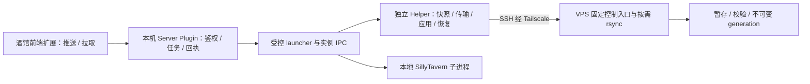

# TavernSyn 技术设计（第一阶段）

本文件保留第一阶段调研结论；认证部分已按 0.1.2 的密码登录更新，当前源码与实际验收进度见[实现报告](implementation.md)。

日期：2026-10-23。项目目录：`D:\TavernSyn`。

## 1. 范围、假设与可验证目标

按需求先设计、核对和做最小技术探针，再实现完整插件。本阶段交付文档与隔离验证程序，不把架构图或探针当作已完成产品。

基线是本机 **SillyTavern 1.19.0 / release / `06bde939fb1e9c4c8d8641d810f0a916b5bce127`**，与[官方最新稳定发布版](https://github.com/SillyTavern/SillyTavern/releases/tag/1.19.0)对应。当前安装关闭多用户和服务端插件，使用 `default-user`。以下默认设计针对一个私人用户在两台可信设备间同步；多用户部署必须显式映射 profile，并由管理员授权，不能直接镜像账户数据库。

“相同使用环境”可能指共享已保存内容，也可能包括任意脚本尚未提交的浏览器内存。可保证的范围是：受支持保存适配器已经确认落盘的内容、停机后的文件、已报告的插件恢复状态。未知脚本内存和浏览器数据库需要单独适配，不能声称自动完整复制。

验收目标：两端各有本地酒馆；只用推送/拉取两个日常按钮；传输失败保留旧有效镜像；本机应用失败有一次恢复数据；自动重启只能操作启动器持有的实例；未受控实例进入明确的待应用状态；密钥不出现在日志中。

| 证据等级 | 本阶段结论 |
| --- | --- |
| 已核对文档与源码 | 前端接入点、保存函数真实语义、插件加载及认证/CSRF顺序、用户目录、退出钩子 |
| 已在隔离 Windows 副本实测 | 原生插件、认证/CSRF/admin、IPC身份、正常请求排空、超时拒绝停机、异步退出、退出后更新模拟文件、同端口新实例启动 |
| 设计方案，尚未实现 | 同步 API、保存回执、等待页、事务 journal、rsync/VPS 协议、安装器、插件恢复 |
| 尚未端到端实测 | 浏览器点击与恢复、断连写入屏障、真实第三方插件、Android、MSYS2 rsync、VPS、回滚与依赖恢复 |

实际结果见[验证报告](verification.md)。没有 VPS 地址、主机指纹或手机环境不妨碍完成本阶段设计；它们是后续真实接入所需信息。

## 2. 架构与原生安装方式



UI 使用根 `manifest.json` 指向 `ui/index.js`，通过 `SillyTavern.getContext()`、模板、事件和请求头接入扩展设置面板。服务端遵循 `info/init/exit` 导出和 `/api/plugins/tavernsyn/` 路由机制。它只管理本机任务，不把系统命令或 SSH 私钥交给浏览器。[UI 官方文档](https://docs.sillytavern.app/for-contributors/writing-extensions/)、[Server Plugin 官方文档](https://docs.sillytavern.app/for-contributors/server-plugins/)。

同一 Git 仓库承载三个组件。安装器可从独立 checkout 运行，也支持先由酒馆原生 Git URL 安装 UI 后运行一次安装入口。安装器完成路径/版本/依赖自检，安装薄服务端入口，结构化设置 `enableServerPlugins: true`，生成 Windows 启动快捷方式或 Termux 启动脚本。它不要求手动复制一组目录，也不默认开启全局自动更新。启用插件的配置改动要备份并明确显示。

Helper 的执行代码复制到普通镜像之外的版本目录，任务固定使用某个代码版本。独立更新安装新版本并切换版本指针，正在运行的任务继续使用原版本。UI、服务端和 Helper 在握手时核对协议版本，升级不匹配则拒绝开始任务。

原生 Git 安装可用不等于可收录官方扩展目录：当前官方提交规范不接受必须依赖 Server Plugin 的 UI 扩展。本项目按自有 Git URL 发布，不承诺官方目录收录。

## 3. 数据目录调查与同步范围

实际调查见 [local-inventory.json](local-inventory.json)。当前 `default-user` 有 225 个文件、约 30.3 MB；全局前端扩展为 JS-Slash-Runner 和 ST-Prompt-Template；没有实际安装的第三方服务端插件。数据根不是只有聊天，还包含全局 CSS、缓存、临时上传、账户存储和会话秘密。依据 [`USER_DIRECTORY_TEMPLATE`](https://github.com/SillyTavern/SillyTavern/blob/06bde939fb1e9c4c8d8641d810f0a916b5bce127/src/constants.js#L16) 和 [`users.js`](https://github.com/SillyTavern/SillyTavern/blob/06bde939fb1e9c4c8d8641d810f0a916b5bce127/src/users.js#L556) 分类。

| 范围 | 默认处理 |
| --- | --- |
| `dataRoot/<profile>/` | 纳入所有普通文件，包括未知扩展自定义目录；已知例外按下表处理 |
| `chats`、`group chats`、`groups`、`characters`、`worlds` | 共享完整内容及元数据，不拆掉 JSONL header、integrity 或角色内嵌扩展数据 |
| `context`、`instruct`、`sysprompt`、`reasoning`、各类模型 Settings、`QuickReplies` | 共享预设、模板、快捷回复及相关资源 |
| `backgrounds`、`User Avatars`、`themes`、`assets`、`user` | 共享图片、附件、工作流、人格资源与主题；`movingUI` 预设资源共享，设备当前布局另行保留 |
| `settings.json`、`secrets.json`、插件持久设置 | 共享；settings 做结构化设备字段投影；密钥只进载荷，不写日志 |
| `stats.json`、`image-metadata.json`、用户 `content.log`、`backups`、`vectors` | 默认保留。向量索引可能随模型/版本失效，记录模型兼容性，必要时重建；不能把它当作原始附件的替代品 |
| 用户 `thumbnails`、根 `_cache`、`_webpack`、`_uploads` | 可再生缓存或在途文件，默认排除；有活动上传/导入时禁止停机，而不是复制半成品 |
| 根 `_css`、自定义 `_errors` | 可移植的普通资源共享；未知全局目录先列出并要求建立范围规则，不静默忽略 |
| 根 `_storage`、`cookie-secret.txt`、`heartbeat.json`、账户/CSRF/会话状态 | 保留设备身份；不共享登录数据库或会话秘密。多用户目录必须显式映射 |
| `config.yaml`、ST 核心、`node_modules`、Git 元数据 | 不做跨平台镜像；服务器配置保留本机，依赖在目标设备恢复 |
| 同步插件代码、控制目录、任务状态、SSH/Tailscale 身份 | 硬性排除；即使用户扩大范围也不能混入普通载荷 |

载荷使用逻辑目录：`users/<profile-id>/`、`global-ui/<extension-id>/`、`server-plugins/<plugin-id>/portable/`，另有环境清单和文件 manifest。同步 profile 的映射由设备配置固定，不接收浏览器任意文件路径。

自定义 dataRoot 从实际启动参数/已解析配置取得并核对真实路径。插件在用户目录之外存储的数据必须显式登记受限额外根及迁移适配器；显示“未配置此范围”并阻止宣称完整环境已同步。

若插件混用全局 `_storage` 保存自定义键，只允许由已登记适配器导出/恢复自己的键，不连同账户/CSRF键复制。两端 ST 核心不属于镜像；默认要求同一已支持 release，版本或数据格式不兼容时先停止应用并提示升级，不能靠同步用户目录隐式升级核心。

## 4. settings.json 与设备差异

整份 `config.yaml` 留在本机。只在安装器和已登记插件适配器中修改明确的键，服务器端口、监听、路径和性能配置不会被远端文件覆盖。可移植服务端功能开关另列在环境清单中，采用明确的安装策略，而不是覆盖 YAML。

settings.json 大部分字段共享。设备字段用受版本管理的 JSON Pointer 表，默认保留：`/power_user/movingUI`、`movingUIState`、`movingUIPreset`、`chat_width`、`font_scale`，以及本插件独立的 `/extension_settings/tavernsyn`。完整准确路径及高级候选见[前端调查](research/frontend.md#4-settingsjson-的设备差异)。未知字段默认共享，不扫描到绝对路径字符串就擅自替换；本地模型地址可由用户增加精确覆盖规则。

拉取停止旧实例后，读取最后一份本机设置，保存各路径的“存在/缺失/null/类型”，合并到候选 JSON；共享镜像则移除本插件设备命名空间和设备字段。使用 JSON 解析和精确树操作，禁止文本替换、任意原型键合并或猜测未知数组结构。类型不兼容时停止并解释，不改成默认值继续。恢复时同时恢复覆盖前文件和设备字段策略。

`accountStorage` 的一部分已写入 settings.json，不能整体排除为“浏览器数据”。其他 localStorage/IndexedDB 不在 V1 文件同步保证内；编辑器偏好和可再生 token 缓存分别说明，避免把浏览器缓存限制误报为聊天丢失。

## 5. 插件安装清单与恢复

清单记录类型、安装范围、目录标识、仓库 URL、实际 commit/branch、manifest 版本、启用状态、本地改动、可移植文件范围、依赖锁文件和恢复结果。Git 只管理插件代码发布，不管理聊天或同步镜像。

| 插件类型 | 恢复方式与限制 |
| --- | --- |
| Git 前端扩展 | Helper 在暂存区 clone/fetch 并检出精确 commit，保留目标自己的 origin/.git；再应用被记录的可移植工作树改动。禁用状态随 settings 同步，保持扩展目录标识一致 |
| CDN/脚本扩展 | 同步脚本定义、URL、启用状态、参数和已落盘变量；无法固定的远端 URL 标记为不可复现；未知浏览器数据库明确列为未恢复，不自动执行或改写脚本 |
| Git 服务端插件 | 暂存恢复源代码及持久资源，按目标平台恢复依赖、执行位和已登记配置覆盖；不传 node_modules、原生二进制和平台绝对路径 |

原生前端安装 API 支持 URL/branch，不提供任意 commit checkout，因此精确 SHA 恢复属于 Helper 实现，不能冒充官方 API。使用原生更新仍可更新插件；下次同步记录更新后的实际版本。恢复期间自动更新会破坏固定版本，需要暂停并验证相应行为，保留明确的用户更新入口。

依赖默认使用锁文件和 `npm ci --omit=dev --ignore-scripts`。需要生命周期脚本或原生构建的插件必须列明程序/版本/脚本策略；只有经过显式信任的已登记安装策略才能执行，不能关闭脚本后又宣称原生模块已经恢复。失败时保留旧安装及数据，并给出具体插件原因。必要插件失败阻止整次应用；允许降级的项目显示“部分恢复/待处理”，不能显示“完全同步成功”。

现有两个扩展的脚本/变量分散于全局设置、聊天 metadata、角色扩展字段、预设和世界书，只同步 extension_settings 会遗漏。JS-Slash-Runner 还有未固定版本的远程依赖；ST-Prompt-Template 的 Monaco 编辑器偏好属于浏览器本机数据。详见[实际扩展调查](research/frontend.md#6-当前两个扩展的迁移调查)。

## 6. 保存、一致性与受控重启

当前没有官方 `flushAll`、`restart`、`CHAT_SAVED` 或 `SETTINGS_SAVED`。`saveSettingsDebounced()` 不返回保存 Promise；直接调用内部 saveSettings/saveChat 也会重排队或吞掉错误。已核对的 `SETTINGS_UPDATED` 无参数，只能唤醒检查，不能直接当本次保存回执。详细源码行号见[前端调查](research/frontend.md)和[后端调查](research/backend.md)。

默认推荐“确认保存 → 短暂受控停机 → 独立快照 → 重启 → 网络传输”。运行中推送停机少，但无法保证跨文件一致；V1 不把它作为默认，先不实现一个容易误认为等价可靠的普通模式。快照必须独立复制或真正 COW，不能硬链接 live 文件。

保存确认：先拒绝正在生成/导入和未完成编辑；给本插件设置命名空间写一次任务回执 nonce，调用官方保存，再由本机插件读回受限 settings 文件、核对 nonce 与可访问设置投影。聊天固定 ID 和内容副本，调用保存后解析实际 JSONL，核对规范化内容与 metadata，而不是只查条数/mtime。世界书、角色和预设需要分别确认落盘；未知编辑器或插件不能确认时停止严格流程。停机后重新核对回执文件摘要，禁止用过时 ACK 快照。

受控启动流程：

1. launcher `fork` 一个 Node bootstrap，保留真正的 ChildProcess 与私有 IPC；绑定安装/配置/dataRoot/profile、实例 nonce 和协议版本。
2. bootstrap 在加载固定版本 ST 前包装 HTTP/HTTPS 创建回调，跟踪请求。Server Plugin 的 router 只能保护自己，不能当作全局写锁。
3. UI 保存确认后，已登记标签页真正导航到不加载 ST 应用脚本的受保护等待页；等待新文档上报加载确认，避免旧页面恢复后直接写回旧内存。
4. 停止接受普通请求，等待正常请求完成；活动生成单独阻止。请求中途断连、业务完成不确定或超时均停止自动停机，不能把 response.close 当写入完成。
5. 父进程发送经身份核对的 IPC；子进程内部 `process.emit('SIGTERM')` 调用本版本清理链路，等待统计和插件 exit hook。launcher 等待真正 exit 后才读/换文件。
6. 同配置/端口启动新子进程，健康检查核对新 nonce、任务、profile 和预期应用代次。端口有响应不代表正确实例已启动。
7. 等待页重新取得受保护状态，确认任务真正成功，再回到经校验的同源页面。停机时接口不可访问，界面显示“正在应用或重启”；准确阶段由持久记录在重连后展示，不虚构实时反馈。

上述 bootstrap 与内部 emit 是**版本绑定兼容适配**，不是 ST 官方重启 API。版本和关键源码指纹不匹配时禁用自动应用，进入兼容降级。Windows 不使用 `child.kill('SIGTERM')`、taskkill 或按端口找 PID 当优雅停机；当前隔离实测已证明内部 emit 路径可行。[Node 信号语义](https://nodejs.org/api/process.html#signal-events)。

等待页不能解决全部浏览器风险：BFCache、旧历史页、未登记标签页、不同 hostname/浏览器都可能保留旧状态。生产自动应用还必须验证服务端实例 epoch 写入屏障：旧实例请求拒绝、新文档重新加载；它涉及前端请求携带标识与核心启动兼容，**本阶段尚未实现或验证**。在屏障及浏览器测试通过前，不把自动拉取应用作为已完成能力。不能仅凭单页遮罩或 BroadcastChannel 宣称其他客户端不会写。

后台第三方插件必须遵守已登记的保存/退出合同，且不留继续写入的独立子进程。无法确认时阻断严格模式并列明插件。停机保证磁盘静止，不会自动提交任意脚本内存。

## 7. 两个按钮与任务状态机

以下是**本项目计划新增**的 API，不是酒馆已有 API：同源 `/api/plugins/tavernsyn/` 下的配置、检查、预览、创建任务、按任务 ID 查询状态及异常覆盖确认。请求只包含枚举、任务 ID 和经过校验的配置字段；不接受命令、任意路径、rsync 参数或私钥内容。配置变更及所有任务均要求管理员身份和现有 CSRF 保护，状态查询同样要求认证。

本机跨进程互斥锁使一个安装只运行一个冲突任务；VPS 另有跨设备排他锁。任务 journal 放在镜像之外，原子写入并记录任务 ID、方向、源/目标代次、实例身份、确认摘要、应用步骤、恢复路径、重试次数、时间及错误类别。重复提交相同任务 ID 返回同一任务，不重复执行。

本机锁需要原子创建及实例所有权记录；心跳过期只表示异常，不能据此夺取锁并覆盖数据。launcher丢失但旧child可能仍在时，先确认真实退出，无法确认则保留锁/任务进入人工恢复。锁丢失也不能退化成按PID或端口操作。

```text
IDLE -> PREFLIGHT -> SNAPSHOT/DOWNLOADING -> VERIFYING
push: VERIFIED -> UPLOADING -> REMOTE_FINALIZING -> PUBLISHED -> SUCCEEDED
pull: VERIFIED -> CHECK_LOCAL -> [AWAITING_CONFIRMATION]
      -> SAVE_ACK -> WAITING_PAGES -> QUIESCING -> STOPPED
      -> APPLYING -> STARTING -> HEALTH_CHECK -> SUCCEEDED
分支: PENDING_APPLY / FAILED / ROLLING_BACK / RECOVERY_REQUIRED
```

推送在 SNAPSHOT 内保存、停机、复制后重启；从静态副本上传。源冻结后新增的本机聊天不会混入已上传批次，成功状态同时告知“快照之后的改动尚未上传”。远端基准在预检后发生变化时停止/要求确认，防止旧设备静默覆盖新代次。

拉取先占用远端锁固定 generation、下载并验证；下载期间本机仍可使用。应用前重新确认本机自上次成功同步基准后的共享内容变化，排除设备字段及可再生缓存。存在未上传内容时确认一次覆盖；确认绑定当前本机 manifest 和远端 generation，过期必须重查。没有同步基准时保守视为需确认，不靠时间戳猜测。

空载荷不得覆盖已有镜像；未初始化远端不得拉取；删除全部核心内容或异常大批删除进入异常预览/确认。正常两按钮流程不增加形式性确认。预览明确显示方向、新增/修改/删除文件与不支持项；dry-run 不能承诺准确传输字节。

## 8. 本机安全应用、恢复与降级

大载荷暂存和恢复目录放在目标数据相同卷的独立工作区；控制目录、SSH 凭据和版本代码在镜像外。预检至少为 live、候选和一次恢复留足空间；Android 空间不足就停止，不退化为原地覆盖。使用短路径，提前检查文件锁、重解析点和目标卷行为。

停止旧实例后保存最终设备字段，校验候选，准备插件依赖。先写持久的操作意图，再逐根把旧目录改名到 recovery，把候选改名到 live。用户数据与多个插件根不是一次全局原子 rename；用写前 journal 记录已完成步骤及逆操作，在酒馆停止时恢复一致性。文件内容/清单先刷盘，journal 的文件及目录刷盘能力按平台验证；Windows 断电持久化不凭 Linux 行为推定。

新实例健康失败时只处理 launcher 确认持有的子进程；确认其退出以后才恢复旧文件及插件。新进程退出不确定时禁止回滚到仍被使用的目录，进入 RECOVERY_REQUIRED，显示恢复路径和步骤。旧恢复数据只在完整健康及内容验证后轮换一次；崩溃后的 launcher 先处理 journal，不能直接把半应用目录当正常数据启动。

未受控实例可下载、验证和保留 PENDING_APPLY；不自动接管或强杀。提示用户关闭当前酒馆并使用安装器生成的受控入口，下次启动前完成待应用任务。也可由用户显式采用停机手动应用步骤；待应用不显示成功。普通未受控实例制作严格推送快照同样需要先安全停机，不用运行中复制冒充同等保证。

Termux 使用相同 Node IPC/启动器思路，给启动脚本和可选 Widget 入口。数据和密钥置于 Termux 私有 HOME；Android 系统回收可能同时终止 launcher/child，wakelock 不能保证不被回收。任务依靠持久 journal 下次启动恢复，浏览器恢复按移动端生命周期另测。[Termux 官方说明](https://github.com/termux/termux-app#termux-application)。

## 9. VPS 目录、锁与发布协议

VPS 初始化创建全新的自定义专用根，写数据集 UUID 标识，绝不复用或清理旧酒馆目录。`incoming`、`generations` 和指针在同一文件系统。只保存当前有效 generation、一个必要前任和正在进行的 stage，不做 Git 历史或自建数据库。

文件布局：`FORMAT.json`、`current.json`、`previous.json`、`incoming/<job>/payload`、`generations/<id>/{payload,manifest.json,COMPLETE.json}` 和不对传输暴露的 `private/` 锁/journal。`COMPLETE` 绑定清单摘要，路径集合及 SHA-256 全部通过才写入。

唯一推荐传输入口为按需 **rsync daemon-over-SSH**。不是常驻 daemon，不监听 873，不增加 HTTP 服务。管理员安装的固定 SSH dispatcher 仅接受控制协议或固定 rsync daemon 启动命令；任务生成一个固定路径的只写上传模块或只读下载模块。对 option 拒绝表做版本实测，不自行解析任意 rsync server 命令。控制消息包含 hello/begin/status/commit/abort 等，载荷通过有上限的 JSON stdin；这都是本项目计划实现的协议。

控制会话持 `operation` 独占锁，传输进程另持 `transfer` 共享锁直到子进程结束。发布/重用/GC 先设置 FINALIZING 拒绝新传输，再取得 transfer 独占锁；控制连接丢失也不能误删仍在传输的 generation。V1 串行化推送和拉取，接受长拉取暂时阻塞另一设备，减少读 pin 与 GC 竞态。

推送以旧 generation 的独立 `reflink=auto` 副本作 stage（不支持则普通复制），不使用硬链接。传输和完整校验后写 COMPLETE/journal，刷盘并移入 generations，最后通过同文件系统原子替换 current 指针发布。原子性与断电持久性分别处理。失败不改变 current；响应丢失用任务 ID+摘要查询是否已提交，不盲目重复发布。

拉取持锁读 current、核对完成标记，将模块绑定到 generation 的真实路径，整个下载不再经过 current。未完成 stage 和标记不匹配的数据集不能拉取。完整远端协议、参数及恢复窗口见[传输设计](research/transport.md)。

## 10. rsync 参数、效率与跨平台预检

基线为 `-rt --omit-dir-times --no-whole-file --delete-delay --partial-dir=.tavernsyn-partial --fsync --info=progress2,stats2 --stats --itemize-changes --outbuf=L --timeout=120 --modify-window=0`，加 Helper 生成的显式 `--rsh` 和受限模块。仅对独立 stage 删除；不用 `-a`、`--links`、`--inplace`、`--append*` 或来源删除。具体理由与真实版本兼容要求见[参数表](research/transport.md#4-rsync-参数基线)，依据 [rsync 官方手册](https://download.samba.org/pub/rsync/rsync.1)。

严格默认对源静态副本和新接收 stage 各进行一次流式 SHA-256 清单扫描，之后不再全树 rsync -c。默认 size+秒级mtime 可能漏掉等长快速改写；manifest 差异找出这些条目，用受控 NUL files-from 和 --ignore-times 定向补传，再校验接收树。未变文件不传内容，变化文件使用块差异；网络增量不等于零本地读盘。未来哈希缓存优化须明确弱化的假设，不能悄悄替代严格默认。

默认不压缩以降低手机 CPU 与复杂度；不能依靠当前不生效的 skip-compress 声称按媒体智能排除。若实测需要，再增加独立文本压缩批次并测试其与删除的关系。

进度区分已处理的逻辑文件大小、literal data 和 rsync 协议发送/接收字节。主要传输量显示 rsync 统计，明确不含 SSH/Tailscale 封装、保活与重传；progress2 不是实际网卡字节。异常重试累计单列，不把一次预览当精确流量预测。

Windows 推荐一套配套的 MSYS2 rsync/OpenSSH/cygpath；Node 使用原生 Windows，路径显式转换，不混用 WSL、Git Bash 和系统 ssh 的路径语义。当前只发现 Git、Node、OpenSSH，没有 rsync；不能因为存在 wsl.exe 就推定 WSL 可用。Termux 使用原生 rsync/OpenSSH 包，避免共享外置存储。

源及目标均预检：Windows 保留名/非法字符/尾部点空格、大小写和 Unicode 冲突、组件与总路径长度、符号链接/junction/reparse point、特殊文件、空间和文件锁。无兼容能力时阻止应用，不能自动重命名破坏角色/聊天引用。不迁移 ACL、owner/group 或原生可执行权限；必要权限由目标安装策略恢复。

## 11. 安全边界

设备端仅允许当前已配置安装和已认证 profile；需要管理员的操作不因“本地访问”而省略权限检查。保持 ST 的登录和 CSRF 保护；维护门控只增加拒绝，不增加认证旁路。Bootstrap/Helper IPC 有实例绑定，不提供浏览器任意执行接口。日志只输出阶段、计数、受控文件路径和错误类别，不输出聊天、settings/secrets 内容、SSH 私钥或带凭据 URL。

SSH 使用专用无 sudo 账户和密码认证，密码保存在本机受限控制目录，通过 ASKPASS 提供给后台 SSH/rsync；不写入命令行、环境变量值或接口响应。使用 StrictHostKeyChecking=accept-new 和独立 known_hosts，首次自动记录身份，身份改变拒绝连接。无需生成设备密钥或手工填写服务器公钥；首次连接需要信任当前 Tailscale 网络与地址。tailnet ACL/grants 限制到目标设备与 SSH 服务。

VPS dispatcher 和账号专属 SSH Match/ForceCommand 由管理员保护，不放在可上传模块中。只接受固定命令和经过格式校验的设备 UUID；持有同一账号密码的设备权限相同，UUID 用于任务归属，不再代表独立认证身份。入口再次检查 Tailscale 来源。自定义存储路径仅管理员初始化时指定；后续只用数据集和任务 ID，拒绝任意路径。所有本机程序用参数数组调用；用户内容走校验过的 JSON，不拼接 shell。

载荷 realpath/包含关系验证和 lstat 检查双向进行；拒绝绝对路径、..、盘符/UNC/设备命名空间、NUL、链接及越界。额外根不得包住控制目录/SSH目录，也不能被它们包住。服务端不能把用户配置的大范围根直接交给带 --delete 的 rsync。[OpenSSH 安全参数](https://man.openbsd.org/ssh_config.5)、[受限模块规则](https://download.samba.org/pub/rsync/rsyncd.conf.5)。

私人 VPS 可按需求保存明文聊天及酒馆 API key，不另加端到端加密。它与 SSH/Tailscale 基础设施凭据分别管理；目录限制与 SSH 加密不等于异盘备份或对 VPS 管理员保密。

## 12. 界面、最终目录与后续实现顺序

面板置于扩展设置，顶层显示设备名、VPS地址、环境/连接状态、最近成功推送和拉取、两个方向按钮、阶段及实际统计。首次配置向导核对依赖、Tailscale地址、可信指纹、数据集和范围。高级区折叠范围/排除、JSON Pointer保留表、插件策略、预览、日志和自检；所有可见按钮必须有实际行为。

最终单仓库布局如下，这是第二阶段目标；当前已存在的文档与 probes 不代表其他文件已实现：

```text
tavernSyn/
  manifest.json                 原生 UI 扩展描述
  ui/{index.js,settings.html,style.css}
  server/index.mjs              原生 server plugin 与受保护 API
  helper/{launcher.mjs,bootstrap.mjs,sync.mjs,apply.mjs}
  adapters/{release-1.19.mjs,plugins/}
  bin/{install.mjs,update.mjs}
  platform/{windows/,termux/}    日常受控启动入口
  vps/{init.sh,dispatcher.py}    一次性初始化与 SSH 控制程序
  tests/{fixtures,unit,integration,e2e}/
  probes/                       第一阶段可复现可行性程序
  docs/{requirements-v2.md,technical-design.md,verification.md,research/}
```

设备控制区另存 device.json、journal、基准 manifest、版本代码和本机 SSH引用；大 stage/recovery 在对应数据卷。它们不随普通镜像发布，也不写入 Git。

实施顺序：先完成单机受控生命周期、保存回执、旧页面写入屏障和崩溃恢复；再用模拟目录实现VPS协议/rsync及断线重试；随后接入完整插件清单/设备配置；最后完成 Windows↔Android 真机及真实 VPS 验收。每一阶段先有可执行失败测试，再接真实数据。[验收矩阵](verification.md)列出了通过标准和当前空白。
